<div align="center">


# Garage WebUI-NG

An admin web UI for [Garage](https://garagehq.deuxfleurs.fr/), the self-hosted, S3-compatible distributed object store.

[](https://github.com/t1nk333r/garage-webui-ng/pkgs/container/garage-webui-ng)
[](LICENSE)
[](backend/go.mod)
[](package.json)

[Features](#key-features) · [Screenshots](#screenshots) · [Quick start](#installation) · [Configuration](#configuration) · [API](#api) · [Authentication](docs/authentication.md) · [Upgrading](docs/UPGRADING.md) · [Roadmap](#roadmap)

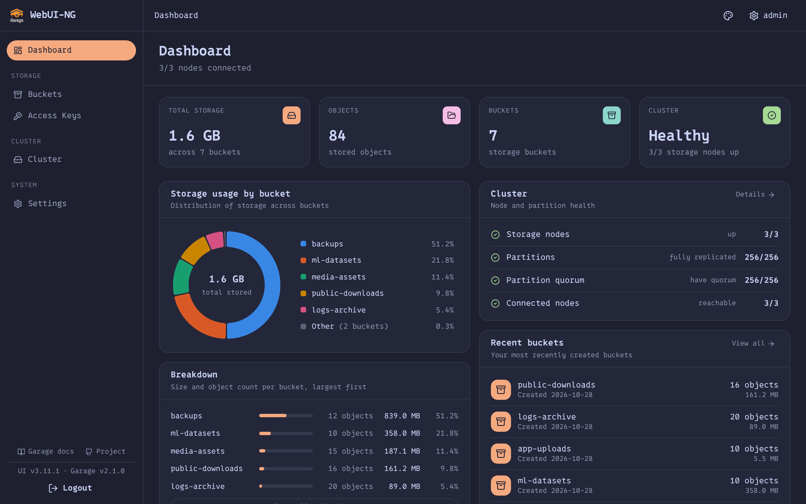

</div>

---

## Overview

Garage WebUI-NG is a web console for running a [Garage](https://garagehq.deuxfleurs.fr/) cluster. It ships as one self-contained binary, or as a Docker image of about 12 MB that runs as a non-root user. The binary is a Go server with the compiled React frontend embedded in it. It works against your existing Garage cluster, and the only state it keeps is a small SQLite database of its own user accounts.

Point it at a running Garage node to manage cluster health, buckets, objects, access keys, static-website hosting and object sharing. It also has its own user accounts, a read-only viewer role and a JSON audit log.

## Key features

- **Dashboard.** Shows cluster health, node and partition status, storage use per bucket as a chart and a ranked list, and recently created buckets. A metrics panel reads S3 requests, errors and block I/O from Garage's Prometheus endpoint.
- **Buckets.** Create, inspect and configure buckets: global and local aliases, quotas, and static website hosting. The UI shows the website's public URL ready to copy, and can generate a directory listing that it keeps up to date.
- **Object browser.** Browse prefixes, upload and download objects, create folders, delete many objects at once, and abort unfinished multipart uploads.
- **Sharing.** One dialog creates an expiring presigned link for a private object, or shows an object's public website URL.
- **Access keys.** Create and inspect keys, and give them read, write or owner permission on a bucket.
- **Users and roles.** A setup wizard creates the first administrator on a new instance, and Settings → Users manages accounts after that. There are two roles: admin, and a read-only viewer limited to an allowlist of requests. Users change their own passwords, and every session is CSRF-protected. Accounts are not configured through environment variables. See [`docs/authentication.md`](docs/authentication.md).
- **Audit log.** Every state-changing request, including denied writes, goes to stdout as one JSON line recording who made it, the action, the path and the status.
- **Layout and themes.** The sidebar groups pages by area, every page has breadcrumbs, and the bucket table sorts by column. Eleven light and dark themes share pastel's rounded controls, and Dark Pastel is the default. Pick one in Settings → Appearance; the choice is saved per browser.
- **Deployment.** The image is built for amd64 and arm64, runs as a non-root user, has a healthcheck, shuts down gracefully and is published to GHCR.

## Screenshots

<div align="center">

| Buckets | Bucket overview |
|:---:|:---:|
| [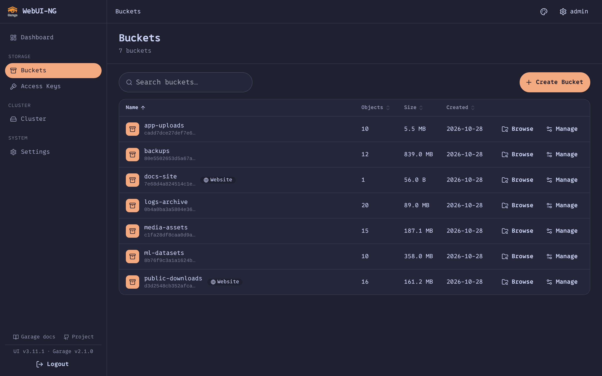](docs/screenshots/buckets-dark.png) | [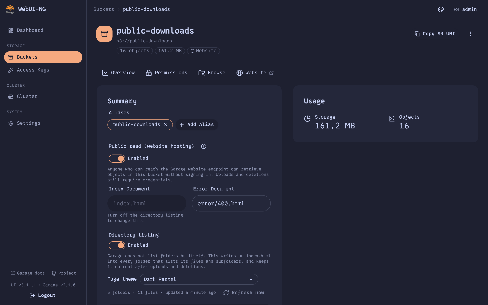](docs/screenshots/bucket-overview-dark.png) |
| **Object browser** | **Share dialog** |
| [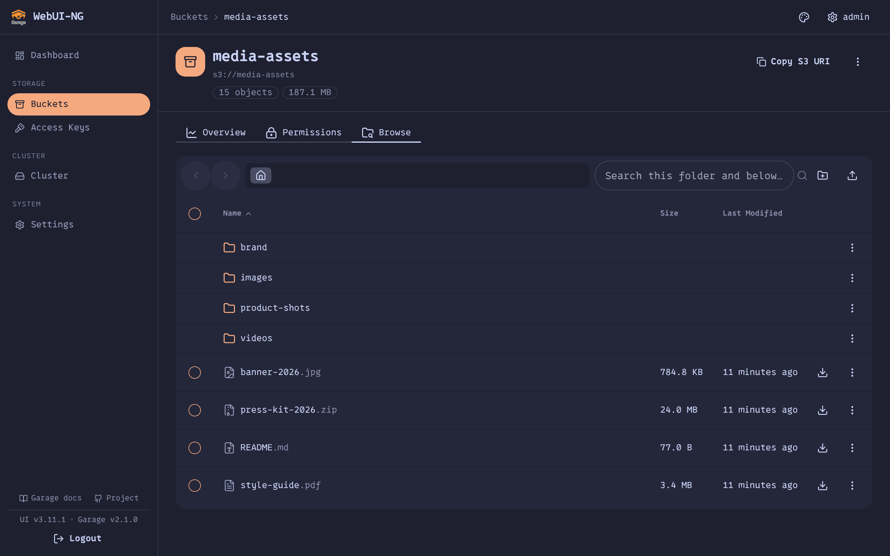](docs/screenshots/browse-dark.png) | [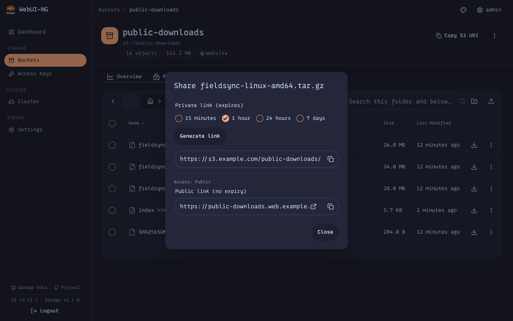](docs/screenshots/share-export.png) |
| **Access keys** | **Cluster** |
| [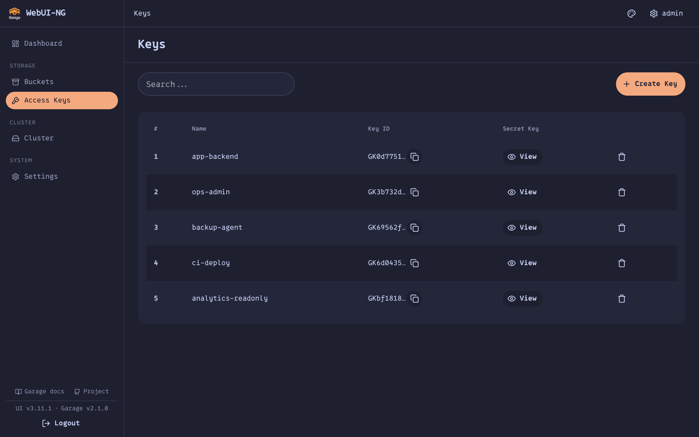](docs/screenshots/keys-dark.png) | [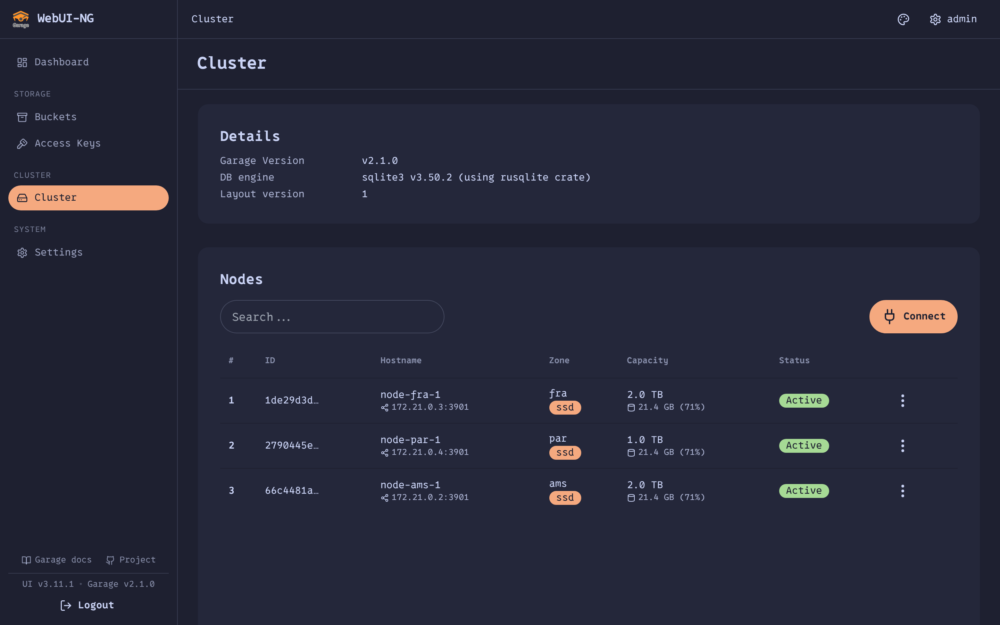](docs/screenshots/cluster-dark.png) |

**Generated directory listing**

[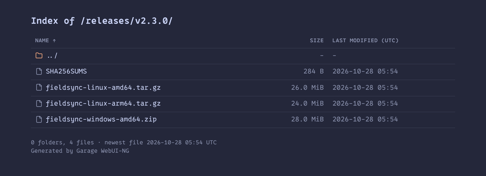](docs/screenshots/directory-listing.png)

| First-run setup | Settings → Users |
|:---:|:---:|
| [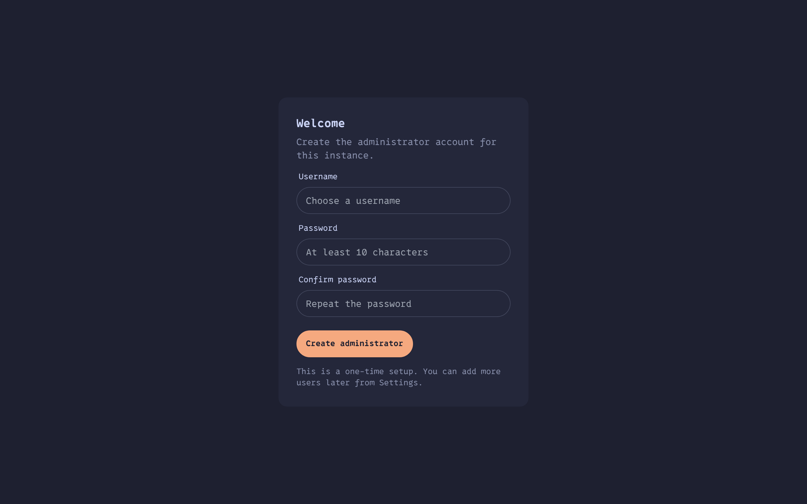](docs/screenshots/setup-wizard.png) | [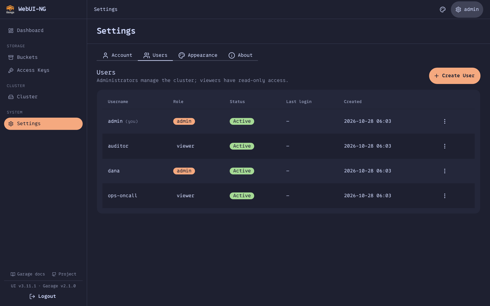](docs/screenshots/settings-users.png) |

**Light theme (Pastel)**

| Dashboard | Object browser |
|:---:|:---:|
| [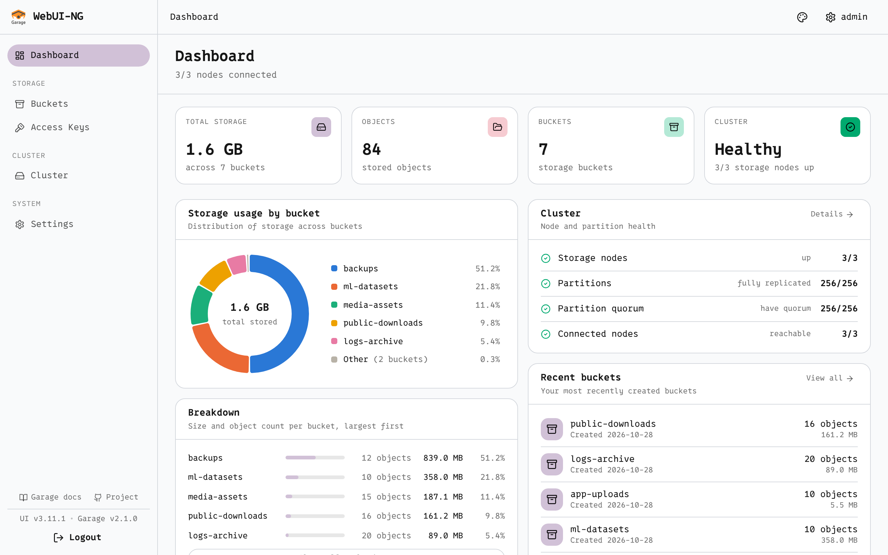](docs/screenshots/dashboard-light.png) | [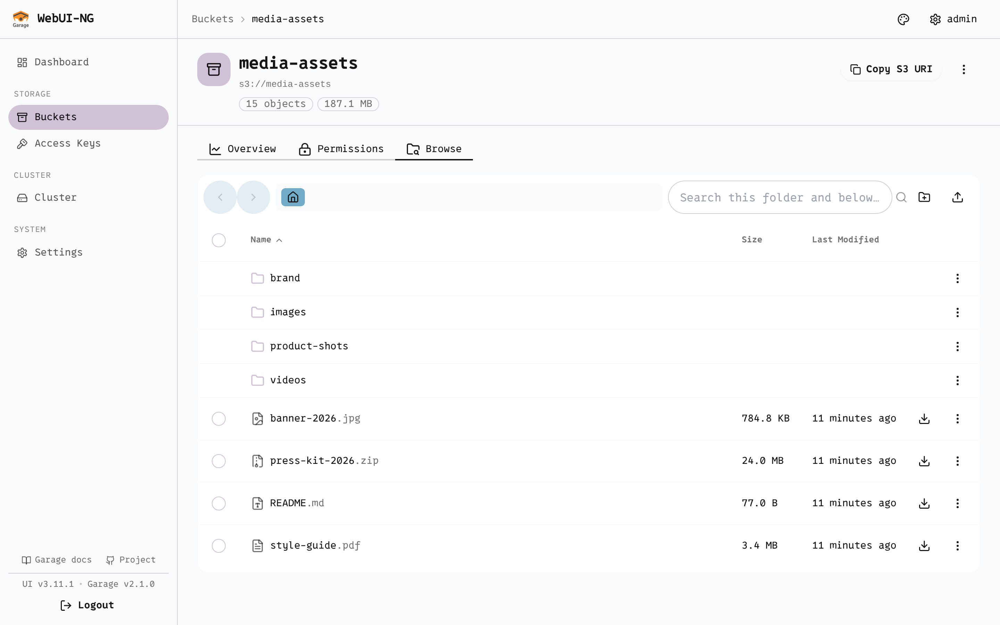](docs/screenshots/browse-light.png) |

</div>

## Architecture

The server passes requests from your browser to two Garage APIs, and keeps a SQLite file of its own user accounts.

```
          ┌──────────────────────────────────────────────┐
          │            Garage WebUI-NG (1 binary)         │
 Browser ─┤  React SPA  ─►  Go server                     ├─► Garage Admin API (v2)
   (SPA)  │   (embedded)     ├─ session auth + roles      │      /v2/GetClusterStatus, …
          │                  ├─ audit log (stdout)        │
          │                  ├─ reverse proxy  ───────────┼─► Garage Admin API (catch-all)
          │                  └─ S3 client ────────────────┼─► Garage S3 API
          │                        │                      │      (object browse / share)
          │                  SQLite (users) ──► /data     │
          └──────────────────────────────────────────────┘
```

- **One binary.** Release builds embed the built frontend in the Go binary with `//go:embed`. The Docker image runs the same binary as a non-root user.
- **Admin API.** A few explicit routes and a catch-all reverse proxy forward `/api/v2/…` requests to Garage's Admin API. The server adds the admin token to each request, and the browser never receives it.
- **S3 API.** Browsing, uploading, downloading and sharing objects go through the AWS SDK v2. The server fetches each bucket's credentials from the Admin API and caches them for an hour.
- **Configuration.** The server reads endpoints and tokens from your existing `garage.toml` (`CONFIG_PATH`, default `/etc/garage.toml`). An environment variable overrides any of them.
- **Local state.** User accounts live in a SQLite file at `DB_PATH` (`/data/garage-webui-ng.db` in the image). **Mount a persistent volume there.** The server stores nothing else locally.

[CLAUDE.md](CLAUDE.md) describes the architecture in more detail.

## Installation

### Docker

```bash
docker run -d --name garage-webui-ng \
  -p 3909:3909 \
  -v ./garage.toml:/etc/garage.toml:ro \
  -v garage_webui_data:/data \
  -e API_BASE_URL=http://garage:3903 \
  -e S3_ENDPOINT_URL=http://garage:3900 \
  --restart unless-stopped \
  ghcr.io/t1nk333r/garage-webui-ng:latest
```

Open http://localhost:3909 and run the setup wizard to create the first administrator.

> The `garage_webui_data` volume at `/data` holds the user database. **Do not leave it out.** Without it, recreating the container deletes every account and the setup wizard starts over.

### Prebuilt binary

Download the `linux/amd64` or `linux/arm64` binary from the [latest release](https://github.com/t1nk333r/garage-webui-ng/releases) and run it next to your Garage node:

```bash
chmod +x garage-webui-ng-linux-amd64
API_BASE_URL=http://127.0.0.1:3903 S3_ENDPOINT_URL=http://127.0.0.1:3900 ./garage-webui-ng-linux-amd64
```

The binary creates the user database at `./data/garage-webui-ng.db` under its working directory. Set `DB_PATH` to keep it somewhere durable. On first start, open the UI and run the setup wizard.

### Updating

- **Docker.** Pull the new image and recreate the container with `docker compose pull && docker compose up -d`. Accounts are on the `/data` volume and survive the update.
- **Binary, from the browser.** Settings → About shows the running version. With `UPDATE_CHECK_ENABLED=true` it also shows whether a newer release exists. An administrator's **Update now** button downloads the release and installs it only if two checks pass. First, the ed25519 signature over `SHA256SUMS` must verify against the public key compiled into the running binary. Second, the binary's SHA-256 must match its entry in `SHA256SUMS`. If either check fails, it installs nothing. On success it keeps the previous binary as `<path>.bak`. The running process serves the old version until the service restarts. The **Restart the service automatically after installing** checkbox makes the process shut itself down after the swap; tick it only when a service manager such as systemd starts the process again. The button is unavailable when the build has no release key, or when the process cannot write its own executable, as in any container or a unit with `ProtectSystem=strict`. When the executable is writable or systemd runs the service, About also lists the manual `systemctl stop`, `install` and `systemctl start` commands with the real unit and binary names filled in. For anything else, such as a container, it says to update the deployment from outside the app.
- **Binary, from the command line.** When Garage and the web UI run side by side under systemd, in an LXC container, a VM or on bare metal, [`contrib/garage-update`](contrib/garage-update/README.md) updates both. Run `garage-update all` on the host or `garage-update-remote all` from a workstation. It verifies each release, backs up the binary and data, and rolls back on its own if the new version fails its health check.

### Verifying a release

Every release publishes the binaries with `SHA256SUMS`, their checksums, and `SHA256SUMS.sig`, an ed25519 signature of `SHA256SUMS`. To verify a download with `sha256sum` and a checkout of this repository:

```bash
# 1. The binary matches the published checksums.
sha256sum -c SHA256SUMS --ignore-missing

# 2. The checksums were signed by the project's release key. <public key> is
#    releasePublicKey in backend/release_key.go at the tag you downloaded;
#    run this from backend/.
go run ./cmd/relsign verify -pub <public key> -in SHA256SUMS -sig SHA256SUMS.sig
```

Both checks must pass. The first one alone says nothing about who produced the checksums.

Releases up to `v3.8.x` were signed with an earlier key that has since been lost, and `v3.9.1` and later use the current one. So a binary older than `v3.9.1` refuses to update itself to a newer release; update it by hand once. [`docs/ci-and-releases.md`](docs/ci-and-releases.md) covers key management.

## Docker deployment

The image is built for `linux/amd64` and `linux/arm64`, runs as a non-root user (uid and gid `65532`), has a healthcheck, and shuts down gracefully on `SIGTERM`.

```bash
docker pull ghcr.io/t1nk333r/garage-webui-ng:latest
```

The `latest` and `main` tags follow the `main` branch, and `sha-<commit>` pins one of its builds. Each release `vX.Y.Z` gets the tags `X.Y.Z`, `X.Y` and `X`. Pin a release in production.

The image declares `VOLUME ["/data"]` for the user database and ships that directory owned by uid `65532`, so a named volume works without setup. To bind-mount a host directory instead, run `chown 65532:65532` on it first, or startup fails with `cannot open user database`.

## Docker Compose deployment

[`docker-compose.yml`](docker-compose.yml) runs Garage and WebUI-NG together. Copy the example env file and start it:

```bash
cp .env.example .env       # edit as needed
docker compose up -d
```

The stack sets up named volumes, restart policies, healthchecks and JSON log rotation, reads its variables from `.env`, and has optional Traefik labels. It mounts the named volume `webui_data` at `/data` for the user database. On first start, open the UI and run the setup wizard. To upgrade an existing deployment, follow [`docs/UPGRADING.md`](docs/UPGRADING.md).

## Configuration

Garage WebUI-NG reads your `garage.toml`, and an environment variable overrides any setting from it. [`.env.example`](.env.example) lists every variable.

### Environment variables

| Variable | Default | Description |
|---|---|---|
| `API_BASE_URL` | from `garage.toml` | Garage Admin API endpoint, used for cluster, bucket and key management. |
| `API_ADMIN_KEY` | from `garage.toml` (`admin_token`) | Overrides the Garage admin bearer token. Pass it from an env file or a secret store, never written into a compose file. |
| `API_ADMIN_KEY_FILE` | *(unset)* | Path to a file holding the admin token. Takes precedence over `API_ADMIN_KEY`, and the trailing newline is ignored. Use it with Compose `secrets:` or a Kubernetes Secret volume. |
| `S3_ENDPOINT_URL` | from `garage.toml` | Garage S3 API endpoint, used to browse, upload and download objects. |
| `S3_PUBLIC_ENDPOINT_URL` | *(unset)* | Public S3 endpoint that browsers can reach. Presigned share links need it. |
| `S3_WEB_PUBLIC_URL` | *(unset)* | Public base URL for website buckets, such as `https://{bucket}.web.example.com`. It replaces the `http://<bucket><root_domain>:<port>` address derived from `garage.toml`. The value must contain `{bucket}`, because Garage picks the bucket from the `Host` header alone; without it the app ignores the value. Set it whenever a reverse proxy is in front of Garage's web endpoint. |
| `LISTING_REFRESH_INTERVAL_MINUTES` | `10` | How often the app checks generated directory listings against their buckets, to catch changes made with other S3 clients. Changes made in this UI update the listing within seconds either way. `0` turns the periodic check off. |
| `MAX_UPLOAD_SIZE_MB` | `512` | Largest single file the object browser accepts, in MB. The server refuses a larger upload with 413 before buffering it. Keep it at or below the body-size limit of any reverse proxy in front of the app, such as nginx `client_max_body_size` or Caddy `request_body max_size`. |
| `S3_REGION` | `garage` | S3 region name. |
| `CONFIG_PATH` | `/etc/garage.toml` | Path to the Garage config file to read. |
| `HOST` | `0.0.0.0` | Address the server binds to. |
| `PORT` | `3909` | Port the server listens on. |
| `BASE_PATH` | *(unset)* | Path prefix to serve the UI under, such as `/garage`. |
| `DB_PATH` | `/data/garage-webui-ng.db` (image)<br>`./data/garage-webui-ng.db` (binary) | SQLite file holding the user accounts. **Keep it on persistent storage.** |
| `SESSION_COOKIE_SECURE` | `false` | Send the session cookie only over HTTPS. Set it to `true` behind TLS. |
| `SESSION_LIFETIME_HOURS` | `24` | Absolute session lifetime, counted from sign-in. |
| `SESSION_IDLE_TIMEOUT_HOURS` | `2` | Sign out a session left untouched for this long. |
| `TRUSTED_PROXY_HEADER` | *(unset)* | Name of a header, such as `X-Forwarded-For`, that carries the real client address. The rate limiters for login, setup and password change key on it. **Set it only when a reverse proxy you control is in front of this service and overwrites the header on every request.** On a directly exposed instance, or behind a proxy that passes the header through unchanged, a client could pick its own rate-limit bucket and get around the limiter. The app reads the last comma-separated entry, the one your proxy appended, never the first. |
| `AUTH_USER_PASS` | *(unset)* | Legacy. Comma-separated `user:bcrypt-hash` pairs. The app imports them once, on the first start against an empty database, and ignores the variable after that. |
| `AUTH_USER_PASS_FILE` | *(unset)* | Path to a file holding the value. Takes precedence over the plain variable, and the trailing newline is ignored. |
| `AUTH_VIEWER_USER_PASS` | *(unset)* | Legacy. Read-only viewer accounts, in the same format and with the same one-time import. |
| `AUTH_VIEWER_USER_PASS_FILE` | *(unset)* | Path to a file holding the value. Takes precedence over the plain variable, and the trailing newline is ignored. |
| `UPDATE_CHECK_ENABLED` | `false` | Check GitHub for a newer release and show the result in Settings → About. Off by default, because it is the only request this service sends anywhere other than the configured Garage cluster. When `true`, the server calls the GitHub releases API at most once every 6 hours, with a 5-second timeout, and caches the answer. A failed check never shows an error. |

> **Environment variables do not configure users.** Create the first administrator with the setup wizard, then manage accounts in Settings → Users. The two `AUTH_*` variables exist only to carry accounts over from a release that predates the database, and changing them afterwards has no effect. [`docs/authentication.md`](docs/authentication.md) has the details.

## Usage

1. On a new instance, open the setup wizard at `/setup` and create the administrator. It signs you in and never opens again.
2. The Dashboard shows cluster health and live metrics.
3. Cluster lists nodes, capacity and the layout.
4. Under Buckets, create a bucket, assign an alias, set quotas or turn on website hosting.
5. Open a bucket's Browse tab to manage objects. Use the Access keys page to create keys and give them access to buckets.
6. Add colleagues in Settings → Users as admins or read-only viewers. Change your own password in Settings → Account.
7. Pick a theme in Settings → Appearance or from the palette menu. Settings → About shows the running version and links to the [project](https://github.com/t1nk333r/garage-webui-ng) and its releases.

### Importing and exporting

- **Upload.** Open a bucket, go to Browse, and use the upload button at the top right of the toolbar to add objects, or the new folder button to create a prefix.
- **Download and share.** Use a row's download action, or Share in the row menu. Share creates a presigned link that expires after 15 minutes to 7 days, or copies the object's public website URL when website hosting is on.
- **Bulk delete.** Select several objects to delete them in one request.

### Permanent public asset URLs

The only way Garage serves objects anonymously is its website endpoint. Public read in this UI is therefore the **Public read (website hosting)** toggle on a bucket's Overview tab. There is no separate ACL or public flag.

1. Create or open a bucket and give it a global alias. Garage derives the
   website hostname from the alias, so it cannot serve a bucket without one.
2. On the bucket's Overview tab, turn on **Public read (website hosting)**.
   Anyone who can reach Garage's website endpoint can now read the bucket's
   objects without signing in. Uploading and deleting still need credentials.
3. Upload an object in Browse. When the upload finishes, the upload panel
   offers **Copy URL**. The row's Share dialog has the same permanent URL, and
   so does its **[Open]** link. The **Website** link at the end of the bucket's
   tab row opens the site itself.
4. Set `S3_WEB_PUBLIC_URL` (see [Configuration](#configuration)) so those URLs
   point at an address your users can reach. Without it, the app derives them
   from `garage.toml`'s `[s3_web] root_domain`, which usually resolves only
   inside your network.

   Check two more things in the deployment:
   - The proxy or load balancer for this hostname must send requests to
     Garage's web port (`s3_web`, port `3902` in the Compose stack), not the
     S3 API port. It must also pass the original `Host` header through
     unchanged, because Garage picks the bucket from that header alone.
   - TLS wildcards do not nest. A certificate for `*.example.tld` does not
     cover `assets.web.example.tld`, because a wildcard matches exactly one
     label. A nested website root domain such as `web.example.tld` needs its
     own `*.web.example.tld` certificate. If public DNS for the zone resolves
     to a private address, an HTTP-01 challenge cannot reach the host, so only
     a DNS-01 challenge can issue that certificate.

### Directory listings

Garage never lists a folder. For a path ending in `/`, its website endpoint
serves the configured index document, and for anything else the error
document. Anonymous visitors cannot list a bucket. So a website bucket returns
404 for its own root unless it contains an `index.html`.

Turn on **Directory listing** in the bucket's website settings and the web UI
writes an `index.html` into every folder. Each page lists the folder's
subfolders and files with their size and date, like an nginx autoindex.
Clicking a column header sorts by name, size or date, and folders stay on top.
The pages use the colors of a web UI theme, either the one you are using when
you publish the listing or another chosen under **Page theme**. They can
instead follow each visitor's light or dark preference.

Before you turn it on:

- **It publishes every file name.** With website access alone, a visitor can
  fetch only a file whose exact name they know. With a listing they can see
  every name. The UI asks for confirmation before turning it on.
- **The pages are real objects.** The object browser shows an `index.html` in
  every folder. The pages are static snapshots. The app updates them about five
  seconds after an upload or deletion made in this UI, and every
  `LISTING_REFRESH_INTERVAL_MINUTES` for changes made with other S3 clients. It
  does not rewrite the page of a folder that has not changed.
- **It never touches your own pages.** Generated pages carry the S3 metadata
  `x-amz-meta-garage-webui-ng-generated: 1`, and the app checks for it
  immediately before every write and every delete. A bucket whose root already
  has an `index.html` of yours cannot have a listing. A subfolder with its own
  `index.html` keeps it, and the app skips that folder.
- **Turning it off removes only the generated pages.** Website access stays on
  and every direct file URL keeps working. Folder URLs return 404 again.
- **Requirements.** The bucket needs a key with read and write permission, as
  the object browser does, and its index document must be a plain file name.
  A bucket with more than 100,000 objects cannot have a listing.
- **Scripts and caching.** The pages are self-contained HTML. Their only script
  sorts the table, and their Content-Security-Policy allows that one script, by
  hash. With scripts blocked the table still works, unsorted. The pages send
  `Cache-Control: no-cache`, so browsers revalidate instead of showing a stale
  listing. If a reverse proxy in front of the website endpoint overrides cache
  headers, exempt HTML from that rule.

### Public access is opt-in

Every new bucket is private. Neither the bucket's name nor a configured
`S3_WEB_PUBLIC_URL` turns public read on. Turning it on in the UI asks for
confirmation, because it makes every object in the bucket readable by anyone.

- Public read maps to exactly one Garage setting, `websiteAccess`, and it
  applies to the whole bucket. Garage has no per-object or per-prefix
  anonymous-read control and no bucket policies, so you cannot make only part
  of a bucket public.
- Turning it off takes effect immediately. Garage then answers anonymous
  requests at the website endpoint with a plain 404, the same response it gives
  for a missing object.
- Presigned links, described in [Importing and exporting](#importing-and-exporting),
  share objects from a private bucket and work the same whether public read is
  on or off.

### Command-line flags

The binary has flags for health checks and account recovery. None of them
starts the server. The account flags work offline on the user database at
`DB_PATH` and then exit.

| Flag | Purpose |
|---|---|
| `-health` | Checks the local server and exits `0` when it is healthy. The container `HEALTHCHECK` runs it. |
| `-list-users` | Prints every account with its username, role, status, last login and creation time. It never prints a password or a hash. |
| `-reset-password <username>` | Prompts for a new password and sets it. Use it for a forgotten admin password; no data is lost. |
| `-create-admin <username>` | Prompts for a password and creates a new administrator, even when accounts already exist. |

```bash
garage-webui-ng -list-users
garage-webui-ng -reset-password admin

# Docker Compose. exec gives the prompt a terminal by default;
# plain `docker exec` needs -it.
docker compose exec webui /main -reset-password admin
```

The flags prompt for the password with echo turned off and never take it as an
argument, since arguments end up in shell history and `ps`. There is
deliberately no HTTP equivalent; these flags need local write access to the
database file. [`docs/authentication.md` §9](docs/authentication.md#9-lockout--recovery)
has the details.

## API

The backend serves everything under `/api`. Any `/api/v2/…` request it does not handle itself goes to Garage's Admin API v2 through the reverse proxy, with the admin token added. The backend also has these endpoints of its own:

| Method | Path | Purpose |
|---|---|---|
| `GET` | `/api/config` | The browser-safe part of the Garage config, with no secrets, plus the running app version. |
| `GET` | `/api/update-check` | Whether a newer release exists. Disabled unless `UPDATE_CHECK_ENABLED=true`. |
| `POST` | `/api/update/apply` | Admin only. Downloads, verifies and stages a newer release binary. See [Updating](#updating). |
| `GET` | `/api/metrics` | Parsed Prometheus metrics for the dashboard panel. |
| `GET` | `/api/buckets` | Bucket list with extra details for the UI. |
| `GET/PUT/DELETE` | `/api/browse/{bucket}/{key...}` | Lists, uploads, downloads or deletes objects. |
| `POST` | `/api/browse/{bucket}` | Deletes the selected objects. |
| `POST` | `/api/browse/download-token` | Issues a short-lived token for downloading selected keys as a ZIP. It is a POST because the key list can be too long for a URL. It changes nothing, which is why a read-only viewer may call it, one of only three POSTs a viewer can make. |
| `GET` | `/api/browse/{bucket}/archive` | Streams the selected objects as a ZIP, given the token above. |
| `GET/DELETE` | `/api/multipart/{bucket}` | Lists or aborts unfinished multipart uploads. |
| `GET` | `/api/share/{bucket}/{key...}?expires=` | Creates a presigned share link. |
| `GET` | `/api/search/{bucket}?q=&prefix=` | Searches object names under a prefix. It stops at 200 matches or 20,000 keys scanned, and sets `truncated` when it does. |
| various | `/api/setup`, `/api/auth/*`, `/api/admin/users*` | Setup wizard, sessions and user administration. |

**[`docs/authentication.md` §6](docs/authentication.md#6-api-reference)**
documents the authentication and user-administration endpoints, with their
request fields, response shapes and every error code. This README does not
repeat them, so the two cannot disagree.

## Security

- **Secrets stay on the server.** `rpc_secret`, `admin_token` and `metrics_token` never reach the browser; `/api/config` returns a filtered subset.
- **Authentication is mandatory.** There is no mode without it. Every API route needs a session except `GET /api/auth/status`, `GET /api/setup/status`, `POST /api/setup` and `POST /api/auth/login`.
- **Passwords.** The app hashes passwords with bcrypt at cost 10 and requires at least 10 characters. No endpoint returns a password or a password hash, and the app never logs one.
- **Sessions.** Sessions are stored on the server. Cookies are `HttpOnly` and `SameSite=Lax`, and `Secure` when `SESSION_COOKIE_SECURE` is set. A session ends at its idle timeout or its absolute lifetime, whichever comes first, and the app renews the session token on every privilege change.
- **CSRF protection.** Every state-changing request must carry a double-submit `X-CSRF-Token`, except login and first-run setup.
- **Login rate limit.** Login allows 10 attempts per minute per client IP, a limit shared with setup and the current-password check. A failed login looks the same, in message and in timing, whether the user is unknown, disabled or gave the wrong password.
- **Roles.** A viewer can read, except secret keys and user administration, and can make only two writes, both to its own account: signing out and changing its password. Two independent checks guard `/admin/*`.
- **Lockout guards.** The last enabled administrator cannot be deleted, disabled or demoted, and no admin can demote or delete their own account.
- **Audit log.** Every state-changing request, denied ones included, goes to stdout as structured JSON for your log pipeline.
- **Hardened image.** The Docker image runs as a non-root user on a distroless base with no shell.
- **Response headers.** The console's own responses carry `X-Content-Type-Options: nosniff`, a strict `Content-Security-Policy` with `frame-ancestors 'none'`, `X-Frame-Options: DENY` and `Referrer-Policy: no-referrer`. The app serves an object body as an attachment unless its stored content type is on a short allowlist of inline-safe image, audio, video, PDF and plain-text types. Even an allowlisted body gets a stricter `Content-Security-Policy: sandbox`, and only the console itself may frame it, which the PDF preview needs. Anyone with S3 write access to a bucket chooses an object's content type, so the app never trusts it to render on the console's own origin. `image/svg+xml` is deliberately not on the allowlist, because an SVG is an XML document that can carry `<script>`.

> The backend uses the Garage admin token on behalf of every signed-in user. Keep the UI on a trusted network, or put it behind a reverse proxy with TLS and set `SESSION_COOKIE_SECURE=true`, before exposing it beyond localhost.

[`docs/authentication.md`](docs/authentication.md) is the full reference.

## Roadmap

- [x] Live cluster metrics panel
- [x] Bulk object delete and multipart cleanup
- [x] Presigned share links and correct website URLs
- [x] Multi-user auth and a read-only viewer role
- [x] Structured audit log
- [x] Persistent user store, first-run setup wizard and in-app user management
- [x] Object-name search in the object browser
- [x] Signed releases and verified in-browser update
- [x] Generated directory listings for website buckets
- [ ] Resumable multipart upload from the browser, for large files
- [ ] More website-hosting settings in the UI
- [ ] Historical metrics view
- [ ] Roles and permissions beyond admin and viewer
- [ ] Multi-factor authentication (TOTP)
- [ ] OAuth, OIDC and LDAP sign-in

## FAQ

**Does this replace Garage?** No. It is an admin UI for an existing Garage cluster. [Install Garage](https://garagehq.deuxfleurs.fr/documentation/quick-start/) first.

**Do I need to run it inside Docker?** No. It is a single static binary, and Docker is only the easiest way to deploy it.

**Why won't a bucket open in the object browser?** The object browser finds buckets by global alias. Give the bucket a global alias first.

**How do I create users or generate a bcrypt hash?** You don't need a hash. Create the first administrator with the setup wizard on a new instance, then add accounts in Settings → Users. The app hashes passwords itself.

There is also a legacy import. On a new instance whose database is still empty, `AUTH_USER_PASS=user:$2a$...`, comma-separated for several accounts, creates those accounts once at startup, and the app ignores the variable after that. It exists to carry a deployment from before the database across the upgrade; see [`docs/UPGRADING.md`](docs/UPGRADING.md). To produce a hash for that one-time import:
```bash
htpasswd -bnBC 10 "" 'your-password' | tr -d ':\n' | sed 's/^$2y/$2a/'
```

**I lost every administrator password. What now?** If one admin can still sign in, reset the other account in Settings → Users. If nobody can and you have shell access to the host, run `garage-webui-ng -reset-password <user>` or `-create-admin <user>`. It prompts for the new password and keeps all data. Deleting the database file erases every account and is the last resort; see [`docs/authentication.md` §9](docs/authentication.md#9-lockout--recovery).

**My users disappear after every deploy.** The `/data` volume is not mounted. See [`docs/UPGRADING.md`](docs/UPGRADING.md).

**Why does lint fail in CI?** Lint has an old backlog of findings, so CI runs it without failing the build. New code must pass it.

## Contributing

Open an issue to discuss a large change before starting it. Before opening a pull request, check that `pnpm run typecheck`, `pnpm run build`, `go build ./... && go vet ./...` and the tests your change reaches all pass; see [Development](#development).

## Development

You need Node 20 or later with `pnpm` (`corepack enable` provides it) and Go 1.25 or later. The `go` directive in `backend/go.mod` is `1.25.0` because `modernc.org/sqlite` requires it.

```bash
pnpm install
pnpm run dev          # Vite (frontend) and air (backend) together
# or separately:
pnpm run dev:client   # frontend only
pnpm run dev:server   # backend only (cd backend && air)
```

Other scripts:

```bash
pnpm run build        # tsc -b && vite build, output in dist/
pnpm run typecheck    # tsc -b
pnpm run test         # Vitest
pnpm run lint         # ESLint

cd backend
go build ./... && go vet ./... && go test -race ./...
```

To run only the tests your change reaches, as CI does:

```bash
pnpm exec vitest related --run <changed files…>
git diff --name-only --no-renames main | .github/scripts/go-affected.sh | xargs -r go -C backend test -race
```

To make a release build, a single binary with the UI embedded, copy `dist/` into `backend/ui/dist/` and run `make`, which builds with `-tags=prod`. The [`Dockerfile`](Dockerfile) does both steps. [CLAUDE.md](CLAUDE.md) has the code conventions and architecture notes.

CI and releases run on GitHub Actions, in [`.github/workflows/ci.yml`](.github/workflows/ci.yml). Pushes to `main` and pull requests run only the tests the change can reach, and skip the frontend or the backend when the change does not touch it. A release tag, the nightly run and a manual run test everything. A push to `main` publishes the image, and a `v*` tag publishes the versioned image and a GitHub release with signed binaries. [`docs/ci-and-releases.md`](docs/ci-and-releases.md) explains how CI picks the tests, how to cut a release and how the signing key works.

## License

Garage WebUI-NG is released under the [MIT License](LICENSE). It is a fork of garage-webui, and the original copyright is kept below, in Acknowledgements. [`THIRD_PARTY_NOTICES.md`](THIRD_PARTY_NOTICES.md) lists material adapted from other projects, with its license.

## Acknowledgements

- [Garage](https://garagehq.deuxfleurs.fr/) by [Deuxfleurs](https://deuxfleurs.fr/), the object storage engine this UI manages.
- [garage-webui](https://github.com/khairul169/garage-webui) by Khairul Hidayat (© 2024), the original project this fork builds on, under the MIT License.
- [garage-ui](https://github.com/Noooste/garage-ui) by Noste (© 2025). The layout, dashboard and bucket table adapt its design and parts of its frontend code, under the MIT License.
